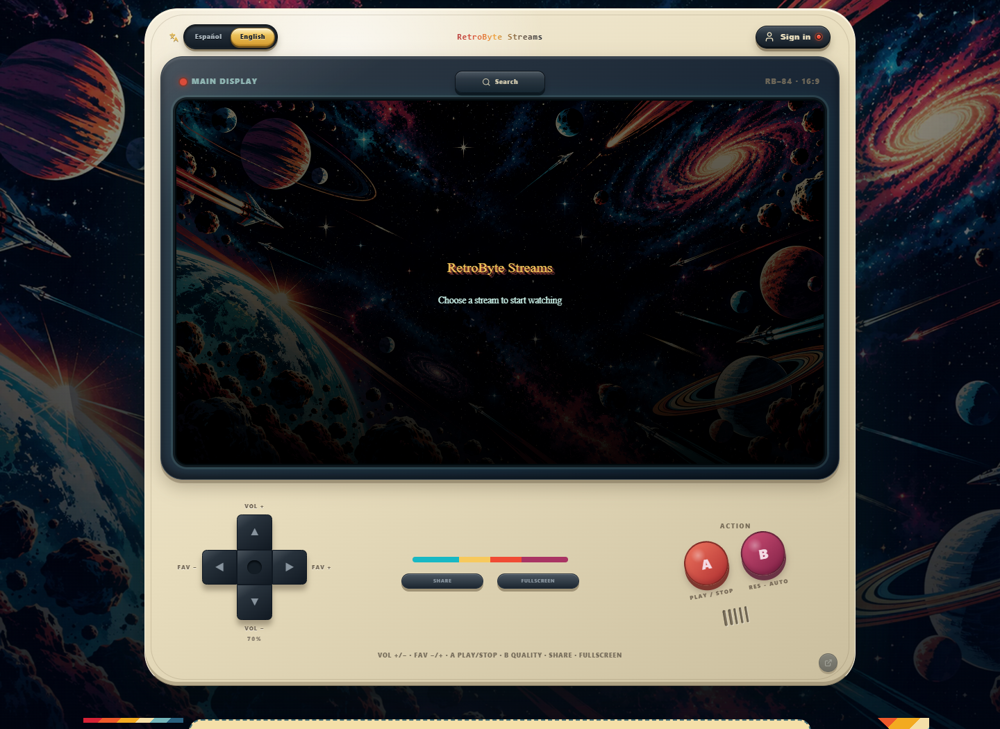
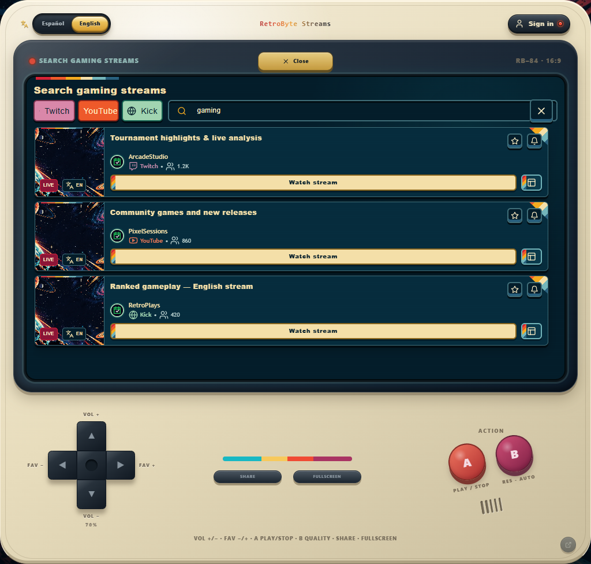
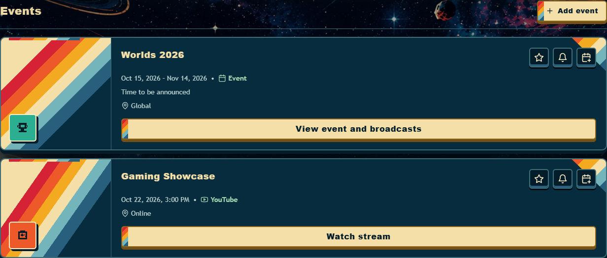
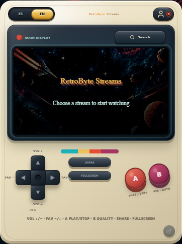
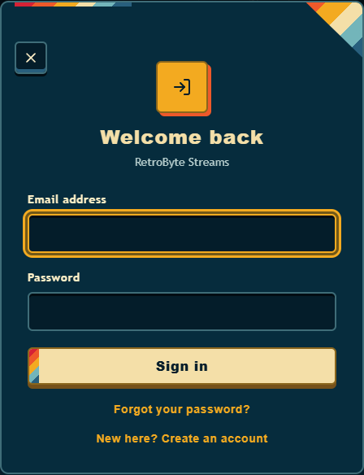

<p align="center">
  
  
  
  
  
  
</p>

<p align="center">
  <a href="https://game-event-manger.netlify.app/"><strong>Open live application ↗</strong></a> ·
  <a href="README.es.md">Leer en español</a> ·
  <a href="#-architecture">Architecture</a> ·
  <a href="#-technical-highlights">Technical highlights</a>
</p>

# RetroByte Streams 🎮

A deployed web application that brings Twitch, YouTube and Kick discovery together with an international events calendar, personal favorites and embedded playback.

This project demonstrates end-to-end web engineering: a custom responsive React interface, typed application logic, server-side API orchestration, PostgreSQL access policies, account flows and automated browser testing.

## 📸 App preview



| 🔎 Unified search | 🗓️ Event calendar |
| --- | --- |
|  |  |

| 📱 Responsive layout | 🔐 Account interface |
| --- | --- |
|  |  |

*Captured from the implemented UI in a local preview with sample search results and calendar entries. External services were mocked or blocked; no personal account data is shown. The mobile image is a browser viewport preview.*

## ✨ Main capabilities

- **Cross-platform discovery:** search Twitch, YouTube and Kick, filter providers and prioritize results by interface language.
- **Embedded viewing:** provider-specific players inside a custom console, with playback, fullscreen, volume and quality controls where the provider API supports them.
- **Multiview:** arrange up to four streams in a single workspace for eligible accounts.
- **Event calendar:** month navigation, category filters, events spanning multiple months, timezone-aware dates and event-specific broadcast choices.
- **Personal organization:** saved streams, favorite events, reminders, custom events and preferred-platform settings, subject to account permissions.
- **Calendar interoperability:** Google Calendar links, individual `.ics` exports and token-based subscription feeds.
- **Rule-based alerts:** match creators, games, tournament text, language or categories, with browser notifications and duplicate suppression while the app is in use.
- **Account lifecycle:** email registration, sign-in, password recovery and password changes, with localized error and confirmation states.
- **English and Spanish:** instant language switching, persisted preference, translated interface text and localized metadata.
- **Public discovery:** shareable search URLs, bilingual HTML guides, structured metadata and a sitemap.

## 🛠 Tech stack

| Layer | Technologies actually used |
| --- | --- |
| Frontend | React 18, TypeScript, Vite |
| UI | Tailwind CSS, custom CSS variables and animations, Lucide React |
| State and utilities | React hooks and Context, `use-debounce`, `date-fns`, browser `Intl` APIs |
| Backend | Supabase Auth, Database, Realtime and Edge Functions |
| Data | PostgreSQL, SQL migrations, Row Level Security policies |
| Server runtime | Deno with TypeScript, Fetch API |
| External integrations | Twitch, YouTube and Kick APIs/embeds; PayPal SDK and APIs; Google AdSense integration code |
| Web APIs | AbortController, IntersectionObserver, Notifications, Clipboard, Web Share and localStorage |
| Quality | Playwright, Node.js test runner, TypeScript compiler, ESLint |
| Delivery | Git, GitHub, Netlify, npm lockfile and environment configuration |

## 🧩 Architecture

The application uses a pragmatic component-and-hook architecture. UI components, stateful hooks, domain utilities and server functions have distinct responsibilities; external credentials stay on the server.

```text
React components
    ├── Hooks + Context → session, preferences, favorites, localization
    ├── Domain utilities → ranking, dates, calendar exports, entitlements
    └── Supabase client
           ├── Auth + PostgreSQL / RLS + Realtime
           └── Deno Edge Functions
                  ├── Provider search + caching
                  ├── Subscription verification + webhooks
                  └── Calendar feed generation
```

| Boundary | Responsibility |
| --- | --- |
| `src/components` | Screens, dialogs, playback adapters and reusable interface elements |
| `src/lib/hooks` | Sessions, remote data, subscriptions and user preferences |
| `src/lib` | Typed models, localization, calendar logic, ranking and capability checks |
| `supabase/functions` | Server-side integrations and privileged operations |
| `supabase/migrations` | Versioned schema changes, access policies and database functions |
| `tests` | Unit tests, desktop/mobile browser tests and isolated advertising scenarios |

## ⚙️ Technical highlights

### Resilient API aggregation

Search requests are debounced in the client and cancelled when superseded. The server queries providers concurrently, normalizes their responses and ranks results by language before audience size. In-memory and database caches reduce repeated upstream requests; provider timeouts and partial-result warnings keep individual failures visible without discarding all useful results.

### Authorization beyond the interface

PostgreSQL RLS policies associate private records with their owners. Account capabilities are loaded from stored profiles; user-editable metadata is not used to grant privileged access. Sensitive operations run in Edge Functions, and provider secrets are separated from public frontend configuration.

### Subscription lifecycle integration

The PayPal implementation includes client-side checkout, server-side subscription lookup, plan and ownership validation, webhook signature verification and an idempotent database update function. This is an example of integrating asynchronous external state with application permissions. Complete payment, renewal and cancellation validation remains a separate release checkpoint.

### Dates that survive real calendar edge cases

Calendar utilities distinguish timed events from all-day events, preserve venue-date semantics and use exclusive end dates for all-day exports. Unit tests cover leap years and events crossing month boundaries. Subscription feeds provide calendar interoperability without claiming instant, bidirectional synchronization.

### Deliberate interface engineering

A retro console provides the visual identity, while reusable panels, dialogs, status messages and controls maintain consistency. Responsive layouts, labeled controls, keyboard dismissal and outside-click handling support everyday usability. Stream selection and search actions also manage viewport navigation so the relevant content stays easy to find.

### Controlled third-party loading

The AdSense integration checks configuration, per-visit opt-in and account eligibility before rendering an ad slot. IntersectionObserver delays requests until the slot is visible. Isolated tests cover blocked scripts, retries, duplicate requests and revocation during loading. Live ad delivery is disabled pending the remaining external approval and validation steps.

## 🧪 Quality and validation

The project contains automated checks for:

- Language ranking, access errors and account capability rules.
- Calendar boundaries, all-day exports and broadcast selection.
- Sign-in and recovery UI, language switching and navigation.
- Desktop/mobile layout, dialogs, search and player transitions.
- Public metadata, static guides, sitemap consistency and source import reachability.
- Advertising opt-in, account exclusions and interrupted loading, using mocks.

```bash
npm run lint
npm test
npm run build
npm run test:e2e
npx playwright test --config playwright.adsense.config.ts
```

The latest local unit run recorded **13 passing tests**, with successful lint and production build checks. Browser suites use controlled external-service responses. They validate application behavior, not real payment settlement, email receipt, provider playback guarantees or advertising revenue.

## 🚀 Delivery and current status

The frontend is deployed on Netlify. Build configuration includes TypeScript checks, security headers and asset caching. SQL migrations, environment templates and Git history support reproducible changes and rollback planning.

| Area | Current scope |
| --- | --- |
| Application UI, discovery, calendar and localization | Implemented; deployed frontend available |
| Favorites, reminders, feeds and account capabilities | Implemented; authenticated or permission-dependent |
| PayPal | Client/server integration implemented; full transaction lifecycle QA pending |
| Google/Twitch account linking | Conditional UI and flow implemented; provider configuration and end-to-end validation pending |
| AdSense | Integration and mocked tests implemented; live delivery remains disabled |

Provider embeds retain their own playback, cookie and advertising rules. Alert matching runs while the application is being used; it is not a background push service. Multiview is independent playback, not a synchronized watch-party system.

## 🎯 Engineering experience demonstrated

- Connecting a custom interface to multiple external services through a typed backend boundary.
- Separating UI availability from database authorization and verified external state.
- Handling asynchronous requests, stale responses, timeouts and partial failure.
- Designing internationalized interfaces and interoperable calendar data.
- Combining automated regression checks with explicit real-service release checkpoints.
- Maintaining a deployed application through versioned changes, documentation and focused UI iteration.

## 📬 Contact

**German Bonnettini · Mate Code Studio**

[GitHub](https://github.com/MateCodeStudio) · [Email](mailto:germanbonnettini@yahoo.com.ar)

Available to discuss the architecture, implementation decisions and a technical walkthrough of the project.
